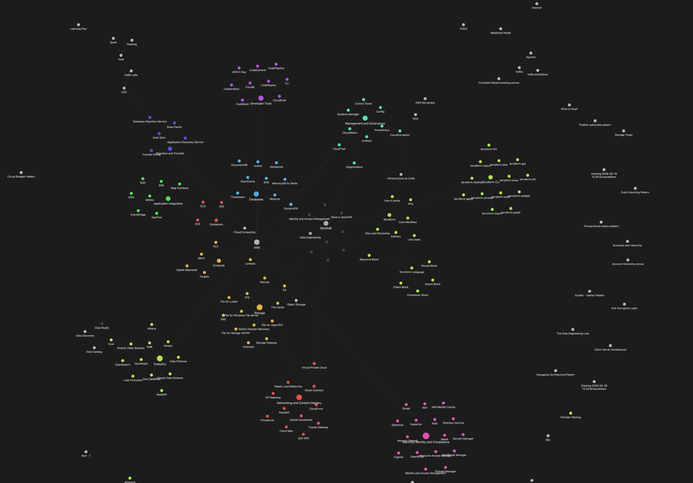

# Merge Into Memory

*When matched, update what I know. When not matched, insert what I don't.*

My personal notes and blog drafts on cloud, data engineering and software. I write them for myself, and share them so others can use them as a reference too.

> **Work in progress.** Most of this notebook is still incomplete: many pages are short, and some are only placeholders. Keep an eye on it, as it will keep growing.



*The notebook in Obsidian's graph view: each dot is a note, and each line is a link between notes.*

## What's inside

| Section | What it covers | State |
| --- | --- | --- |
| [AWS](Cloud/AWS/AWS.md) | Notes organised by service category | Some detailed pages, many placeholders |
| [Terraform](Terraform/Terraform.md) | Core concepts, language and style guide | Growing; CLI pages are placeholders |
| [Data](Data/) | Data basics and data engineering concepts | Early |
| [Architectural Patterns](Architectural%20Patterns/) | Saga, circuit breaker, pub-sub, strangler fig and more | Short summaries |
| [Apache](Apache/) | Kafka, Spark and Hudi | Early; mostly Kafka |
| [IT Fundamentals](IT%20Fundamentals/) | Networking, storage types, Git, Infrastructure as Code | Early |
| [MoM](MoM/) | Assorted concept notes: CDC, Hudi, authentication and others | Rough |
| [Blogs](Blogs/) | Longer articles | Drafts |

## Good places to start

- [What is Data?](Data/What%20is%20Data%3F.md)
- [Data Engineering](Data/Data%20Engineering/Data%20Engineering.md)
- [Amazon S3](Cloud/AWS/Storage/S3.md)
- [AWS Lambda](Cloud/AWS/Compute/Lambda.md)
- [Amazon DynamoDB](Cloud/AWS/Databases/DynamoDB.md)
- [Amazon VPC](Cloud/AWS/Networking%20and%20Content%20Delivery/Virtual%20Private%20Cloud.md)
- [AWS IAM](Cloud/AWS/Security%2C%20Identity%20and%20Compliance/Identity%20and%20Access%20Management.md)
- [AWS Organizations](Cloud/AWS/Management%20and%20Governance/Organizations.md)
- [Terraform resource blocks](Terraform/Terraform%20Language/Resource%20Block.md)

## Reading the notes

This is an [Obsidian](https://obsidian.md) vault. GitHub shows the text, but it does not follow `[[wiki links]]` or display `![[embedded]]` images and drawings. For the full experience:

1. Clone the repository:
   ```bash
   git clone https://github.com/sandeepevani/merge-into-memory.git
   ```
2. In Obsidian, choose **Open folder as vault** and select the cloned folder.
3. Enable community plugins if you trust them. The [Excalidraw](https://github.com/zsviczian/obsidian-excalidraw-plugin) plugin is needed to view the drawings.

## Corrections

These are learning notes, so expect gaps and the occasional mistake. Check the official documentation before relying on a detail such as a limit or a price. If you spot something wrong, please [open an issue](https://github.com/sandeepevani/merge-into-memory/issues) or send a pull request.

## Sources

Many notes summarise or quote official documentation (such as AWS and HashiCorp) and other learning material, and some diagrams come from those sources. They remain the property of their respective owners.
